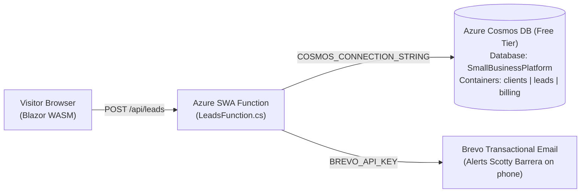

# Southern Shield Waterproofing Website

A high-performance, configuration-driven **$0/month small business website, lead capture, and customer inquiry platform** for **Southern Shield Waterproofing** built with **Blazor WebAssembly (.NET 10)**, **Azure Static Web Apps Managed Functions (.NET 10)**, **Azure Cosmos DB (Multi-Tenant Free Tier)**, **Cloudflare Email Routing**, and **Brevo Transactional Email**.

---

## Business Profile

* **Company Name:** Southern Shield Waterproofing
* **Owner:** Scotty Barrera
* **Phone:** (423) 661-9481
* **Email:** Southernshieldwaterproofing@gmail.com
* **Service Area:** Southeast Tennessee (Chattanooga, Cleveland, Athens & surrounding communities)
* **Services:**
  * Foundation Footing Treatment
  * Waterproofing Wall Membrane
  * Drainage Systems (French Drains)
  * Backfill Protection
* **Brand Colors:**
  * Primary Shield Blue: `#156ab7`
  * Safety Foundation Orange: `#e65c0f`

---

## Architecture Overview



---

## Repository Structure

* `Client/` — .NET 10 Blazor WebAssembly PWA
  * `wwwroot/appsettings.json` — Complete brand configuration, color palette, services list, copy, and contact form settings
  * `wwwroot/images/logo.png` & `logo.jpg` — Official Southern Shield Waterproofing brand logos
  * `Models/SiteConfiguration.cs` — Strongly typed configuration models
  * `Layout/MainLayout.razor` — Dynamic CSS variable injection and responsive layout
  * `Pages/` — `Index.razor`, `About.razor`, `Services.razor`, and `Contact.razor`
* `Api/` — .NET 10 Isolated Azure Functions (Azure Static Web Apps Managed API)
  * `LeadsFunction.cs` — `POST /api/leads` endpoint with honeypot spam protection, native Cosmos DB REST storage, and Brevo email notifications
* `database/cosmos_schema.json` — Cosmos DB document schema
* `scripts/`
  * `sync-client-config.py` — Auto-generates `index.html`, `sitemap.xml`, `robots.txt`, and `manifest.webmanifest` from `appsettings.json`

---

## Email Setup: Sending & Receiving with the Custom Domain

The email setup provides a **100% free, professional custom domain email workflow** operated directly from Scotty's personal Gmail inbox (`southernshieldwaterproofing@gmail.com`).

### 1. Inbound Inquiries (Cloudflare Email Routing — Active)
Any emails sent to the company domain:
* `info@southernshieldwaterproofing.com`
* `scotty@southernshieldwaterproofing.com`
* `contact@southernshieldwaterproofing.com`

are automatically forwarded directly to `southernshieldwaterproofing@gmail.com` in real time with zero hosting fees.

---

### 2. Outbound Emails: Send from Gmail as `@southernshieldwaterproofing.com`

Scotty can compose new emails or reply to customer inquiries directly from Gmail so that recipients see the sender as `scotty@southernshieldwaterproofing.com` or `info@southernshieldwaterproofing.com`.

Two setup methods are supported. **Method A (Brevo SMTP)** is recommended because `southernshieldwaterproofing.com` has active DKIM cryptographic signatures and DMARC alignment verified in Brevo.

#### Method A: Using Brevo SMTP Relay (Recommended)

1. Open **[Gmail](https://mail.google.com)** on a desktop web browser, signed into `southernshieldwaterproofing@gmail.com`.
2. Click the **Gear icon (Settings)** in the top right corner ➔ click **See all settings**.
3. Select the **Accounts and Import** tab.
4. In the **"Send mail as:"** section, click **Add another email address**.
5. In the pop-up window:
   * **Name:** `Scotty Barrera` (or `Southern Shield Waterproofing`)
   * **Email address:** `scotty@southernshieldwaterproofing.com` (or `info@southernshieldwaterproofing.com`)
   * **Treat as an alias:** Keep checked
   * Click **Next Step >>**.
6. On the **"Send emails through your SMTP server"** screen, enter:
   * **SMTP Server:** `smtp-relay.brevo.com`
   * **Port:** `587`
   * **Username:** `c2487a001@smtp-brevo.com` *(or Brevo account login email)*
   * **Password:** `<Your Brevo API Key / SMTP Key>` *(available in your Brevo Dashboard or Agency Portal)*
   * **Secured connection using TLS:** Checked (recommended)
   * Click **Add Account**.
7. **Verify the Address:**
   * Gmail sends a confirmation email containing a verification code to `scotty@southernshieldwaterproofing.com`.
   * Because Cloudflare Email Routing is forwarding to Gmail, this verification email arrives immediately in `southernshieldwaterproofing@gmail.com`.
   * Copy the verification code from the email, paste it into the prompt, and click **Verify** (or click the confirmation link in the email).
8. **Configure Default Reply Behavior:**
   * In Gmail Settings under **Accounts and Import** ➔ **Send mail as:**
   * Select **"Reply from the same address the message was sent to"**.
   * *(Optional)* Click **"make default"** next to `scotty@southernshieldwaterproofing.com` if Scotty wants all new emails to default to his domain address.

---

#### Method B: Using Google App Password (Native Gmail SMTP)

Alternatively, Scotty can send using Google's own SMTP servers (our Cloudflare SPF record includes `_spf.google.com`):

1. **Generate a Google App Password:**
   * Go to **[Google Account Security](https://myaccount.google.com/security)** for `southernshieldwaterproofing@gmail.com`.
   * Ensure **2-Step Verification** is turned ON.
   * Open **[App Passwords](https://myaccount.google.com/apppasswords)**.
   * Name it `Southern Shield Domain Alias` and click **Create**.
   * Copy the generated 16-character password (e.g. `abcd efgh ijkl mnop`).
2. **Add to Gmail:**
   * In Gmail Settings ➔ **Accounts and Import** ➔ **Send mail as:** ➔ click **Add another email address**.
   * **Name:** `Scotty Barrera`
   * **Email address:** `scotty@southernshieldwaterproofing.com`
   * Click **Next Step >>**.
   * **SMTP Server:** `smtp.gmail.com`
   * **Port:** `587`
   * **Username:** `southernshieldwaterproofing@gmail.com`
   * **Password:** The 16-character Google App Password (without spaces).
   * **Secured connection using TLS:** Checked.
   * Click **Add Account** and confirm via the verification code sent to the inbox.

---

## Local Development & Build

```bash
# Build Client and Api
dotnet build SouthernShieldWaterproofing.slnx

# Run Blazor WASM client locally
dotnet run --project Client/SmallBusinessSite.Client.csproj
```

