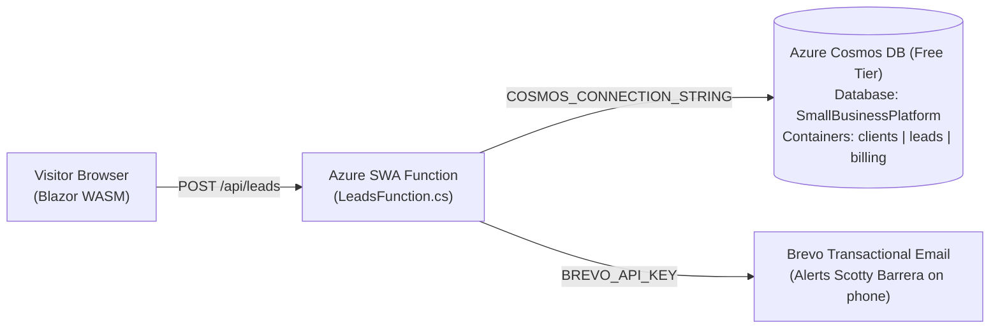

# Southern Shield Waterproofing Website

A high-performance, configuration-driven **$0/month small business website, lead capture, and customer inquiry platform** for **Southern Shield Waterproofing** built with **Blazor WebAssembly (.NET 10)**, **Azure Static Web Apps Managed Functions (.NET 10)**, **Azure Cosmos DB (Multi-Tenant Free Tier)**, **Cloudflare Email Routing**, and **Brevo Transactional Email**.

---

## Business Profile

* **Company Name:** Southern Shield Waterproofing
* **Owner:** Scotty Barrera
* **Phone:** (423) 661-9481
* **Email:** Southernshieldwaterproofing@gmail.com
* **Service Area:** Southeast Tennessee (Chattanooga, Cleveland, Athens & surrounding communities)
* **Services:**
  * Foundation Footing Treatment
  * Waterproofing Wall Membrane
  * Drainage Systems (French Drains)
  * Backfill Protection
* **Brand Colors:**
  * Primary Shield Blue: `#156ab7`
  * Safety Foundation Orange: `#e65c0f`

---

## Architecture Overview



---

## Repository Structure

* `Client/` — .NET 10 Blazor WebAssembly PWA
  * `wwwroot/appsettings.json` — Complete brand configuration, color palette, services list, copy, and contact form settings
  * `wwwroot/images/logo.png` & `logo.jpg` — Official Southern Shield Waterproofing brand logos
  * `Models/SiteConfiguration.cs` — Strongly typed configuration models
  * `Layout/MainLayout.razor` — Dynamic CSS variable injection and responsive layout
  * `Pages/` — `Index.razor`, `About.razor`, `Services.razor`, and `Contact.razor`
* `Api/` — .NET 10 Isolated Azure Functions (Azure Static Web Apps Managed API)
  * `LeadsFunction.cs` — `POST /api/leads` endpoint with honeypot spam protection, native Cosmos DB REST storage, and Brevo email notifications
* `database/cosmos_schema.json` — Cosmos DB document schema
* `scripts/`
  * `sync-client-config.py` — Auto-generates `index.html`, `sitemap.xml`, `robots.txt`, and `manifest.webmanifest` from `appsettings.json`
  * `onboard-client.py` — Agency CLI to sync Cosmos DB, Cloudflare DNS/Email, and Brevo settings

---

## Local Development & Build

```bash
# Build Client and Api
dotnet build SouthernShieldWaterproofing.slnx

# Run Blazor WASM client locally
dotnet run --project Client/SmallBusinessSite.Client.csproj
```
